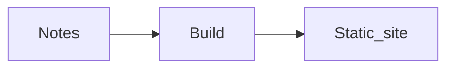

# Glorious Manta

A lightweight static blog built from Markdown with [Eleventy](https://www.11ty.dev/). No client-side framework.

## Write

Add posts to `content/posts`:

````md
---
title: A useful title
date: 2026-02-20 19:00:00
categories: [Microsoft Fabric, Spark]
tags: [fabric, spark]
---

Markdown, <mark>inline HTML</mark>, and Mermaid all work.


````

## Run locally

```sh
npm install
npm start
```

`npm run build` writes the static site to `_site`.

## Cosmos DB visuals

The Cards-theme drafts and calculator code live in `_includes/visuals/cosmos-db-ru`. The public, self-contained HTML exports live in `public/visuals/cosmos-db-ru`.

After editing a draft, `interactive.js`, or `interactive.css`, regenerate and check them:

```sh
npm run visuals:cosmos-ru
npm test
npm run build
```

Regeneration uses the installed `answer-me-with-html` CLI at `~/.agents/skills/answer-me-with-html/scripts/am.mjs`. Set `AM_CLI` to use a different path. Normal site builds use the committed exports and do not need the renderer.

The export step removes the renderer's branding, toolbar, embedded draft and feedback runtime. It keeps Cards styling and adds only the local calculator code, with an updated script hash in the Content Security Policy. No comments, replies, analytics or network calls are included. Inputs stay in the browser; bar transitions respect reduced-motion settings.
