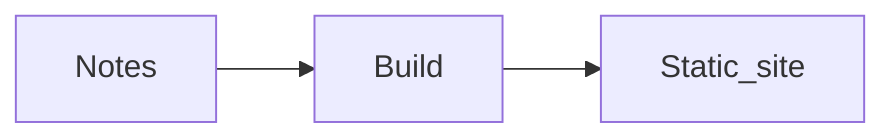

# Glorious Manta

A lightweight static blog built from Markdown with [Eleventy](https://www.11ty.dev/). No client-side framework.

## Write

Add posts to `content/posts`:

````md
---
title: A useful title
date: 2026-02-20 19:00:00
categories: [Microsoft Fabric, Spark]
tags: [fabric, spark]
---

Markdown, <mark>inline HTML</mark>, and Mermaid all work.


````

## Run locally

```sh
npm install
npm start
```

`npm run build` writes the static site to `_site`.

## Cosmos DB visuals

The Visual Explainer sources (`*.src.html`), shared styles and local controls live in `_includes/visuals/cosmos-db-ru`. The public, self-contained HTML exports live in `public/visuals/cosmos-db-ru`. The write visual has Create/Replace/Patch tabs; the query visual shows lookup and fan-out work. The workload calculator retains editable rates and charges.

After editing a source, `interactive.js`, or `interactive.css`, regenerate and check them:

```sh
npm run visuals:cosmos-ru
npm test
npm run build
```

Regeneration uses the Visual Explainer CLI at `~/.pi/agent/git/github.com/nicobailon/visual-explainer/plugins/visual-explainer/kit/render.mjs`. Set `VE_CLI` to override it. The script stages sources in `~/.agent/diagrams` (or `VISUAL_EXPLAINER_OUTPUT_DIR`). Render those staged sources with the Visual Explainer tool for its browser checks. Normal site builds use the committed exports and do not need the renderer.

The export step removes the kit runtime and external font links. It keeps the figures and adds the local controls with a script hash in the Content Security Policy. Public visuals contain no feedback UI or network calls. Tabs support arrow keys, Home and End; without JavaScript, all write examples remain visible. Inputs stay in the browser and respect reduced-motion settings. Tests also check the Python article examples with a mock Cosmos container; no live credentials are required.

## Live Cosmos DB measurements

`public/visuals/cosmos-db-ru/measurements-2026-11-04.json` records the West Europe experiment: response charges, indexing policies, EUR retail rates and resource cleanup checks. Collection notes identify the manual/serverless reporting errors rather than treating partial reports as complete runs. An empty Cost Management result does not establish a zero bill.

The article includes short SQL/Python examples for the measured operations. The temporary benchmark collector is not included. Tests validate the recorded charges and article snippets offline; they do not provision or contact Azure resources.
