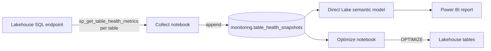

At FabCon, Sam Debruyn pointed me to `sys.sp_get_table_health_metrics`, a system stored procedure on the lakehouse **SQL analytics endpoint**. You pass it a Delta table and it tells you whether the table's file layout needs maintenance. Thanks, Sam.

Table maintenance matters because neglected tables get slow. Small files pile up, deleted rows stay on disk, and every query opens more files than it needs. I'll write a separate post on Delta maintenance itself. This post covers how I monitor it across a whole lakehouse.

## What the procedure checks

You call it once per table:

```sql
EXEC sys.sp_get_table_health_metrics @table_name = N'dbo.sales';
```

It returns a single row built from file-level metadata. The procedure doesn't scan your data. The row contains:

- `PotentialAnomalyType` and `PotentialAnomalyDescription`: the verdict
- Totals: `FileCount`, `FileSizeInBytes`, `PhysicalRowCount`, `DeletedRowCount`, `DeletedBitmapCount`
- Delta versions: `SnapshotVersion` and `CheckpointVersion`
- Histograms that bucket the files by row count, deleted row count and file size

The anomaly type is one of five codes:

| Code | Anomaly | Fix |
|---|---|---|
| 0 | None | Nothing to do |
| 1 | Invalid file statistics | Check the Delta log, re-run ingestion or `OPTIMIZE` |
| 2 | Many deleted rows | `OPTIMIZE` to rewrite files without the deleted rows |
| 3 | Many small files | `OPTIMIZE` to compact, and look at your ingestion batch sizes |
| 4 | No recent checkpoint | `OPTIMIZE` or trigger a checkpoint from Spark |

Keep two things in mind when you read the result. The procedure reports one anomaly per call, the most severe one. After you fix the small files, the next run can flag a stale checkpoint on the same table. The thresholds also come from the SQL analytics endpoint engine, which wants around 2 million rows and 1.2 GB per file. The [documentation](https://learn.microsoft.com/en-us/sql/relational-databases/system-stored-procedures/sp-get-table-health-metrics-transact-sql?view=fabric) explains how to read the histograms against those targets.

You need `VIEW DEFINITION` on the endpoint. The endpoint is read-only, so `OPTIMIZE` has to run from Spark.

## No overview in Fabric

I wanted one view of every table in a lakehouse, healthy or not. As of October 2026 I couldn't find one in Fabric. The procedure takes one table per call, and Microsoft's own [tutorial](https://learn.microsoft.com/en-us/fabric/data-warehouse/tutorial-conditional-lakehouse-optimization) wraps a pipeline around a single table. The Lakehouse explorer lets you run maintenance table by table, and the Monitor hub shows maintenance job runs. Neither shows you the file layout of all your tables side by side.

So I built one:



## Collecting health for every table

My first attempt used T-SQL alone. The endpoint doesn't support `INSERT ... EXEC` or cursors, so you can't collect the procedure's output into one result set there. A notebook can.

The collect notebook takes the source lakehouse and the place to store the results as parameters. The target can be a dedicated monitoring lakehouse or the source lakehouse itself:

```python
# Parameters
workspace = "my-workspace"
source_lakehouse = "bronze"
target_workspace = None  # None = current workspace
target_lakehouse = "monitoring"
target_table = "table_health_snapshots"
```

It connects to the SQL endpoint with `notebookutils` and lists the user tables:

```python
conn = notebookutils.data.connect_to_artifact(source_lakehouse, workspace, "Lakehouse")

tables = conn.query(
    "SELECT s.name AS schema_name, t.name AS table_name "
    "FROM sys.tables AS t JOIN sys.schemas AS s ON t.schema_id = s.schema_id "
    "WHERE t.is_ms_shipped = 0 ORDER BY s.name, t.name"
)
```

Then it calls the procedure for each table. A failed call gets recorded as an error, so a table you couldn't check never shows up as healthy:

```python
frames = []
for schema, table in tables[["schema_name", "table_name"]].itertuples(index=False):
    qualified = f"[{schema}].[{table}]".replace("'", "''")
    try:
        df = conn.query(f"EXEC sys.sp_get_table_health_metrics @table_name = N'{qualified}'")
        df["error"] = None
    except Exception as exc:  # a failed call is 'unknown', never healthy
        df = pd.DataFrame([{"error": str(exc)}])
    df.insert(0, "table", f"{schema}.{table}")
    frames.append(df)

result = pd.concat(frames, ignore_index=True)
```

Each row gets a status (`healthy`, `unhealthy` or `unknown`) and a snapshot timestamp:

```python
def to_status(row):
    if pd.notna(row["error"]):
        return "unknown"
    return "healthy" if row["PotentialAnomalyType"] == 0 else "unhealthy"


result["status"] = result.apply(to_status, axis=1)
result.insert(0, "snapshot_ts", snapshot_ts)
result.insert(1, "workspace", workspace)
result.insert(2, "lakehouse", source_lakehouse)
```

The notebook appends the result to a Delta table with the `deltalake` library. Write through the OneLake `abfss://` path: the `/lakehouse/default` mount doesn't support the file renames `deltalake` performs. Every run adds a snapshot, which gives you history for free.

## The report

On top of `table_health_snapshots` sits a small Direct Lake semantic model with one table, and a one-page report. You can filter on workspace, lakehouse and health status. The report shows the share of healthy tables over the last 30 days. The maintenance priorities table lists each flagged table with the procedure's reason, its file count, average file size and a suggested action.

The first scan of our lakehouse flagged 67 of 139 tables:


Most of them had too many small files. One table spread its data over 26 files of 0.8 MB on average. The fix for that is `OPTIMIZE`.

## Fixing the unhealthy tables

A second notebook reads the latest snapshot and runs `OPTIMIZE` on every table with status `unhealthy`. It starts in dry-run mode and refuses to run on a snapshot older than 24 hours. The loop:

```python
def quote(qualified):
    schema, table = qualified.split(".", 1)
    return f"`{schema}`.`{table}`"

results = []
for name in unhealthy["table"]:
    if dry_run:
        print(f"[dry run] would optimize {name}")
        results.append({"table": name, "result": "dry_run"})
        continue
    start = time.time()
    try:
        sql = f"OPTIMIZE {quote(name)}" + (" VORDER" if vorder else "")
        metrics = spark.sql(sql).collect()[0]["metrics"]
        results.append({
            "table": name, "result": "optimized", "seconds": round(time.time() - start, 1),
            "files_removed": metrics["numFilesRemoved"], "files_added": metrics["numFilesAdded"],
        })
    except Exception as exc:
        results.append({"table": name, "result": "failed", "seconds": round(time.time() - start, 1), "error": str(exc)[:500]})
```

After the `OPTIMIZE` run and a new scan, 133 of 139 tables came back healthy. A few tables failed to compact because of an error and still show up as unhealthy, so those go on my list:


Wait a few minutes before you re-run the collect notebook. The SQL endpoint metadata can lag behind the `OPTIMIZE` commit. To keep the small files from coming back, look at [optimized write and auto compaction](https://learn.microsoft.com/en-us/fabric/data-engineering/lakehouse-table-maintenance) on the ingestion side.

## Try it yourself

The Power BI project (`.pbip`) is on [GitHub](https://github.com/ThibauldC/fabric-monitoring-stuff/tree/main/lakehouse-table-health). To set it up:

1. Build your own collect step from the snippets above and schedule it. A daily run is enough to build up a trend. The repository's README lists the columns the report expects in `table_health_snapshots`.
2. Open `LakehouseTableHealth.pbip` in Power BI Desktop and point the Direct Lake expression in `expressions.tmdl` at the lakehouse that holds `table_health_snapshots`.
3. Allow the HTML Content custom visual if your tenant asks for it, then publish.
